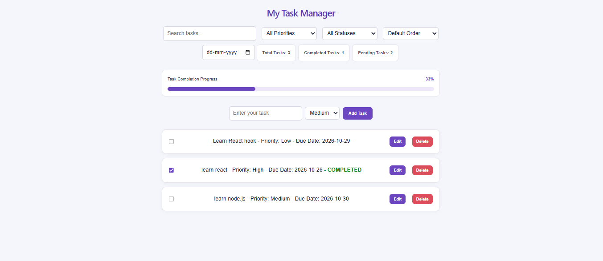

# React Task Manager

A task management application built using React and Vite. This application helps users organize tasks, track progress, and manage priorities and due dates.

## Features

- Add new tasks
- Edit and delete tasks
- Mark tasks as completed
- Set task priorities
- Add due dates and identify overdue tasks
- Search tasks by name
- Filter tasks by priority and status
- Sort tasks
- View task statistics and progress
- Save tasks in the browser using localStorage
- Responsive user interface

## Technologies Used

- React
- JavaScript (JSX)
- HTML
- CSS
- Vite
- Browser localStorage

## Getting Started

### Prerequisites

Install Node.js and npm before running the project.

### Installation

1. Clone this repository:

   ```bash
   git clone https://github.com/Harinirdy/ReactTaskManager.git
   ```

2. Open the project folder:

   ```bash
   cd ReactTaskManager
   ```

3. Install dependencies:

   ```bash
   npm install
   ```

4. Start the development server:

   ```bash
   npm run dev
   ```

5. Open the local URL displayed in the terminal in your browser.

## Data Storage

Tasks are stored in the browser using localStorage. They remain available after refreshing the page in the same browser, unless the stored data is cleared.

## Author

Harini Loka

## Screenshot


